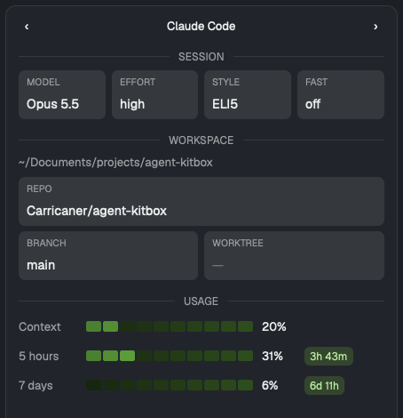
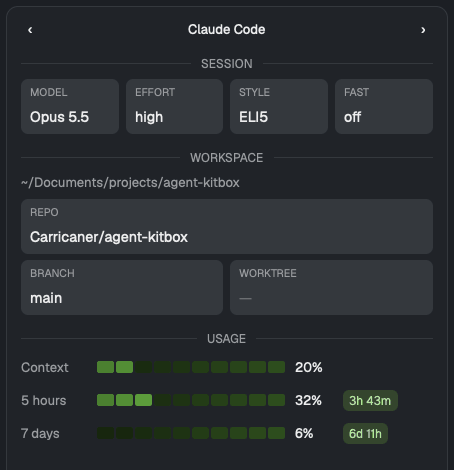

# Status Hub for Herdr

A small Herdr panel with three pages. Use the arrows to switch pages. It remembers your choice.

- **Claude Code**
  - Session: model, effort, output style, fast mode.
  - Workspace: current folder, repository, branch, worktree.
  - Usage: context, five-hour and seven-day limits, with reset countdowns.
- **Codex**: the same usage bars and countdowns, in blue.
- **Docker**: container cards and their status, grouped by Compose project.

**Claude Code page**



<br>

**Animation**



- When a tile's value changes, a white line runs once around its edge.
- When a usage bar gains or loses a lit segment, each segment's frame lights in turn.
- Both take 0.5 seconds.

## Requirements

- Herdr Desktop, Bash, `jq` and Python 3.
- Claude page: Claude Code with a shell status line.
- Docker page: the Docker CLI and a local Docker daemon.

## Install

1. Clone this repository.
2. Copy `herdr/status-hub/mods/status-hub` to `${HERDR_APP_HOME:-~/.config/herdr-app}/mods/status-hub`.
   - If a mod with that name already exists, check it before you overwrite it.
3. Run `herdr-app check` on the installed folder.
4. Add the mod to a **personal** layout. You can ask your Herdr agent:

   > Read `~/.config/herdr-app/AGENTS.md`, then add the installed `status-hub` mod below my Files panel. Add a button to show and hide it. Do not modify shipped layouts or mods.

   - The panel is one copy of the mod. Give it the layout ID `panel-claude-usage`.
   - The button is another copy with `props: {"toggle": true}`.
   - The right sidebar needs the ID `panel`.
5. Wrap your Claude Code status line, so the panel gets usage data.
   - Back up `~/.claude/settings.json` first.
   - Set `statusLine.command` to `bash <absolute path to mods/status-hub/capture.sh> <your existing status-line command>`.
   - Example: `~/.claude/statusline.sh` becomes `bash ~/.config/herdr-app/mods/status-hub/capture.sh ~/.claude/statusline.sh`.
   - Does your command use pipes, quotes, shell operators or `VAR=value`? Move it into its own script and pass that script instead.
   - No status line yet? Pass a script that reads its input and prints nothing.
   - The wrapper still sends the same input to your program and shows its output.
6. Use Claude Code until the status line updates.
   - No update for five minutes shows `stale`.
   - Fields Claude Code does not send show `—`.

## Update

1. Back up any changes you made to the installed mod.
2. Pull the repository.
3. Copy `main.js`, `mod.json`, `capture.sh`, `codex-usage.py` and `VERSION` into the installed mod folder.
4. Run `herdr-app check` again.

## Check the version

```sh
cat "${HERDR_APP_HOME:-$HOME/.config/herdr-app}/mods/status-hub/VERSION"
```

- This shows the version you copied. It does not check for updates or notice your own edits.
- Release notes: [changelog](CHANGELOG.md).

## Data and limits

**Claude Code**

- The wrapper saves only these, to `data/claude-usage.json` in the Herdr app home:
  - usage percentages and reset times;
  - model, effort and output style names, and whether fast mode is on;
  - current folder, repository, branch and worktree names;
  - when it was updated.
- It never saves passwords, keys or conversation text.
- It runs `git branch --show-current` in the current folder to find the branch. A detached HEAD shows `—`.
- In a Herdr terminal, it also saves one copy per terminal in `data/claude-sessions/`.
- The page follows the Claude pane you focus:
  - Session, workspace and context come from that pane.
  - Five-hour and seven-day limits come from the newest update of any session.
  - Before you focus a Claude pane, or before it updates, the page shows the latest session.
- Old per-terminal files are not deleted. They are small.
- The wrapper and Herdr must use the same `HERDR_APP_HOME`.

**Codex**

- No setup needed.
- Reads token counts from the 10 newest session files in `${CODEX_HOME:-~/.codex}/sessions`.
- Context comes from the latest session with usage data, not always the focused one.
- Data older than five minutes shows `stale`. Missing values show `—`.
- Shows only usage and reset data. The session files themselves can hold conversation text.

**Docker**

- Runs `docker ps -a` every five seconds while the Docker page is selected, even when the panel is hidden.
- Reads only container names, status and Compose project labels.
- Never starts, stops or changes containers.
- Containers without a Compose label go under Standalone.
- A green dot means running and not reported unhealthy. It does not mean a health check passed.
- Docker errors show as unavailable.
- Remote Docker hosts are not supported.

## Checks

Run from the repository root:

```sh
node herdr/status-hub/test.mjs
python3 herdr/status-hub/test_codex_usage.py
herdr-app check herdr/status-hub/mods/status-hub
```
